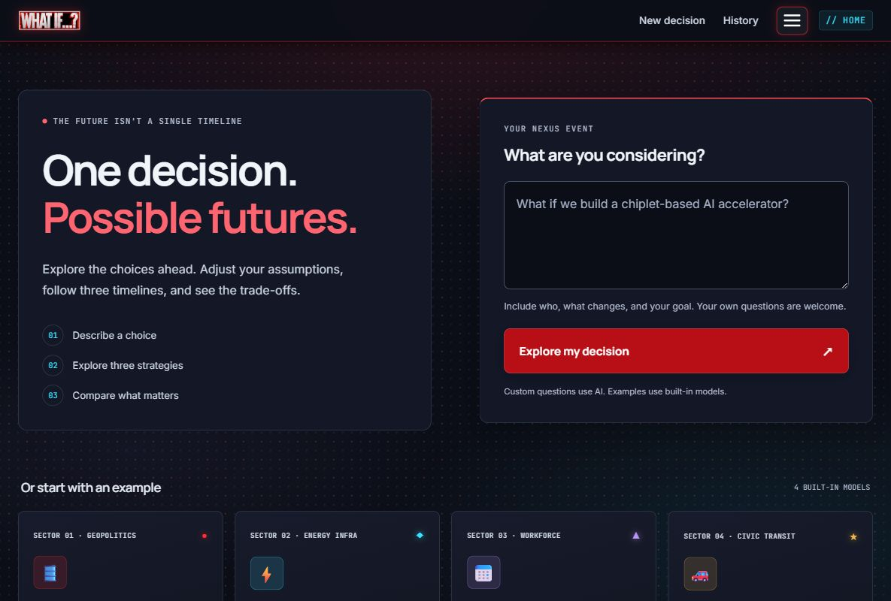
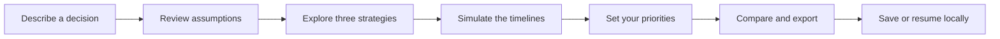
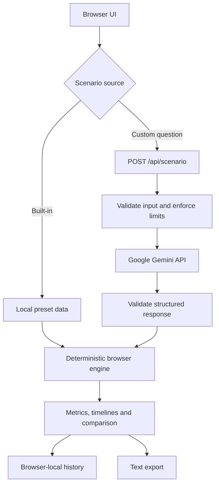

<p align="center">
  
</p>

<h1 align="center">One decision. Possible futures.</h1>

<p align="center">
  Explore three strategies. Change your assumptions. Compare the trade-offs.
</p>

<p align="center">
  <a href="#quick-start">Run locally</a> ·
  <a href="#how-it-works">How it works</a> ·
  <a href="#architecture">Architecture</a> ·
  <a href="#deployment">Deployment</a> ·
  <a href="SECURITY.md">Security</a>
</p>

<p align="center">
  
  
  
</p>

**WhatIf** is a decision exploration app with a cinematic multiverse interface. Start with a built-in scenario or ask your own question, explore three alternative strategies, adjust the assumptions, and compare the outcomes against your priorities.

The distinction matters: **AI creates the custom scenario; explicit equations drive the simulation.** Results are illustrative decision-support models, not predictions, probabilities, or professional advice.



## What you can do

| Capability | What it gives you |
| --- | --- |
| **Ask your own question** | Gemini generates three relevant strategies, stakeholders, assumptions, benefits, risks, and trade-offs through a private server-side gateway. |
| **Start without an API key** | Four built-in models run in the browser, with no AI request required. |
| **Explore three timelines** | Compare A, B, and C through an interactive branch view, metric cards, and Canvas charts. |
| **Change the assumptions** | Scenario-specific controls recalculate the model. Custom scenarios expose resource, uncertainty, and pace controls. |
| **Choose what matters** | Weight cost, risk, speed, and impact to see how the ranking changes. |
| **Resume a decision** | Restore saved questions, generated scenarios, variables, and priorities from this browser's local history. |
| **Take the result with you** | Download a plain-text decision summary with the question, verdict, parameters, assumptions, and priorities. |

The interface keeps its dark indigo, crimson, chrome, and cyan identity while using softer app typography, responsive layouts, visible keyboard focus, and cursor-following light confined to individual panels. The semiconductor futures intro keeps its cinematic card treatment; you can also go straight to the app. Touch and reduced-motion modes suppress the decorative cursor effects.

## Quick start

**Requires Node.js 22.9 or newer.** There is no build step and no npm package installation is required.

```sh
git clone https://github.com/svpg10/whatif.git
cd whatif
npm start
```

Open **[http://localhost:8000](http://localhost:8000)**. Select an example, choose **Explore my decision**, review the pre-simulation notice, and follow the timeline flow.

### Enable custom questions

1. Copy [`.env.example`](.env.example) to `.env`. Use `cp .env.example .env` on macOS/Linux or `Copy-Item .env.example .env` in PowerShell.
2. Add your Google Gemini API key to `GEMINI_API_KEY`. Keep it in the local file or your host's secret manager.
3. Restart `npm start` and enter your own question.

```dotenv
GEMINI_API_KEY=your_google_ai_studio_key
GEMINI_MODEL=gemini-3.5-flash-lite
```

`GEMINI_MODEL` is configurable; use a structured-output model enabled for your Google API account. The value above is the app's configured default, not a guarantee of availability for every account. Built-in examples continue to work when the key is absent.

For a custom question, include **who is deciding, what changes, and the intended goal**. For example:

> What if our chip design team adopted a chiplet architecture to reduce redesign time while keeping the packaging budget fixed?

Missing context is handled through explicit generated assumptions. You can edit the question, review the strategies, and change the controls before comparing them. Do not put credentials or sensitive personal information into a question.

## How it works



### Built-in scenarios

| Scenario | Decision being explored |
| --- | --- |
| **The Strait Closes** | India's response to a 30-day oil-chokepoint disruption. |
| **500 Chargers** | Expanding a city's EV charging network. |
| **The 4-Day Week** | Changing a company's working schedule. |
| **No Cars Downtown** | Restricting cars in a city centre. |

### What the numbers mean

- **Built-in scenarios** use explicit teaching heuristics in [`js/engine.js`](js/engine.js). They are not calibrated economic, transport, or workforce forecasts.
- **Custom scenarios** begin with AI-generated baseline scores. The engine then applies deterministic adjustments for resources, uncertainty, and implementation pace.
- **Trajectories** show illustrative day 0–90 movement. A scenario with a multi-year implementation horizon is not a claim that implementation finishes within 90 days.
- **Rankings** use four higher-is-better indices: cost efficiency, safety, delivery speed, and impact. They depend on both assumptions and priorities.

```text
Overall score = sum(dimension score × priority weight) / sum(priority weights)
```

A zero weight excludes that dimension. If all four weights are zero, the app uses equal weights. Repeating the same calculation with the same scenario and controls gives the same result; generating a new AI scenario can produce different baseline content.

## Architecture

A small stack with separate responsibilities: vanilla browser code, a Node HTTP server, and Google's Gemini API for custom scenario creation.



The API key stays on the server. A custom request sends the question to Google; it does not send the browser's saved decision history or local identifier. There is no application database, user account system, or cross-device synchronisation.

### Repository map

```text
whatif/
├── index.html                  Main app shell and hash-based routes
├── landing.html                Standalone cinematic intro
├── privacy.html                Privacy notice
├── ai-disclaimer.html          Simulation limitations
├── server.cjs                  Allowlisted static server and Gemini gateway
├── lib/scenario-schema.cjs     Structured-output schema and shared validator
├── js/
│   ├── app.js                  Routing and global navigation
│   ├── app-ui.js               Shared panel glow, masking and UI refinements
│   ├── presets.js              Scenario definitions and state helpers
│   ├── home.js                 Decision entry and example selection
│   ├── analysis.js             Scenario preparation and assumptions
│   ├── engine.js               Deterministic calculations
│   ├── multiverse.js           Timeline branching
│   ├── simulate.js             Simulation dashboard
│   ├── charts.js               Canvas line and radar charts
│   ├── compare.js              Priority scoring and export
│   ├── history.js              Local persistence and restoration
│   └── intro.js                Semiconductor futures intro
├── css/
│   ├── styles.css              Original cinematic design system
│   ├── app-ui.css              App typography, layout and panel effects
│   └── legal.css               Privacy/disclaimer layout
├── assets/                     Existing logos, illustrations and audio
├── docs/images/                Actual app screenshots for this README
├── tests/                      Node tests with mocked Google responses
├── .env.example                Configuration template; contains no key
├── SECURITY.md                 Controls, limits and deployment notes
└── UX-NOTES.md                 UI decisions and verification notes
```

## Configuration

| Variable | Default | Purpose |
| --- | --- | --- |
| `GEMINI_API_KEY` | Unset | Enables custom scenario generation. Never expose it in frontend code. |
| `GEMINI_MODEL` | `gemini-3.5-flash-lite` | Google model used for structured scenario output. |
| `HOST` | `127.0.0.1` | Bind address; local startup is loopback-only. |
| `PORT` | `8000` | HTTP listening port. |
| `APP_ORIGIN` | Derived localhost origin in development | Exact public HTTPS origin required in production, without a trailing slash. |
| `NODE_ENV` | Unset | Set to `production` for public hosting. |
| `MAX_REQUESTS_PER_IP` | `10` | Custom requests per connection address per hour, per process. |
| `MAX_REQUESTS_PER_HOUR` | `50` | Total custom requests per hour, per process. |

The gateway also limits concurrent upstream requests to three. Limits are in memory, reset on restart, and do not coordinate across replicas. Behind a reverse proxy, clients can share the proxy's connection-address bucket; `X-Forwarded-For` is deliberately not trusted. Failed provider attempts count toward the budget.

## Verification

```sh
npm test
```

Tests use Node's built-in test runner and **mock Google responses**, so they do not spend API quota.

| Area | Checks |
| --- | --- |
| Decision models | Custom routing, every exposed slider's effect, finite scores, priority weights, baseline/radar consistency. |
| Persistence | Corrupt-storage recovery and restoration of saved custom scenarios and controls. |
| Gateway | Structured responses, private-file/path denial, origin/content/input checks, rate limits, provider failures, deadlines, and missing configuration. |
| Interface | Per-box light ownership and cleanup, input routing, direct intro entry, and unavailable storage/animation fallback. |
| Cinematic preservation | Original card rendering/timeline code and protected media/style hashes. |

Browser QA notes are in [`UX-NOTES.md`](UX-NOTES.md). These checks are not a full accessibility certification, a calibrated model validation, or an independent penetration test.

## Deployment

### GitHub repository and static preview

Pushing this repository publishes the source. **GitHub Pages serves only the static frontend:** the four built-in scenarios can run there, but Pages cannot run `server.cjs` or `/api/scenario`. A Pages preview therefore does not enable custom AI questions. Publishing source and configuring a public application host are separate steps.

### Vercel: enable the existing hosted website

The project includes Node functions for `/api/scenario` and `/api/status`, an allowlisted frontend build, and `vercel.json` configuration. Follow the [Gemini setup guide](docs/GEMINI-SETUP.md) for the exact Vercel fields and troubleshooting.

For `https://whatif-red.vercel.app`, add **Production** environment variables `GEMINI_API_KEY` (your private key), `APP_ORIGIN=https://whatif-red.vercel.app` (no trailing slash), and optionally `GEMINI_MODEL`. Then redeploy. A local `.env` file does not configure Vercel.

`GET /api/status` reports whether a key is present, without returning it or making a Google request. A successful custom question is still needed to validate permissions and quota. On Vercel, request limits apply to each warm function instance, not globally across scaled instances.

### Other Node hosts

Use a Node-capable host behind managed HTTPS. Serve the frontend and API from the **same origin**.

1. Check out the repository. No build command or dependency installation is required.
2. Inject `GEMINI_API_KEY` through the host's secret manager.
3. Set `NODE_ENV=production`, `APP_ORIGIN=https://your-domain.example`, and the host-provided `PORT`.
4. Set `HOST=0.0.0.0` only if the platform requires a container bind address. Keep the service behind the platform's HTTPS proxy.
5. Start with `npm start`. Apply provider quota controls and suitable request limits before exposing the API.
6. Publish the operator contact and actual hosting-log retention details described in the privacy notice.

The bundled server exposes only approved public app files. Use it rather than a generic directory server that could serve `.env` or Git metadata. The custom API is public and rate-limited; it is **not authenticated**. For multiple replicas or broader public use, add shared abuse controls appropriate to the deployment.

See [`SECURITY.md`](SECURITY.md) for the implemented controls, remaining limits, and incident response notes.

## Troubleshooting

| Symptom | What to check |
| --- | --- |
| Built-in examples work, but a custom question does not | Start the Node server, configure the key, and restart it. A static host cannot run the custom API. |
| “Custom questions are not configured yet” | `GEMINI_API_KEY` is absent from the server environment. |
| “AI service is unavailable” | Check the Google account's model access and quota. Try again without replacing the question. |
| “Custom-question limit reached” | Wait for the hourly window, adjust limits responsibly, or use a built-in example. |
| Production startup rejects the configuration | Set `APP_ORIGIN` to the exact HTTPS origin. |
| History is missing | Records belong to one browser profile and origin. Clearing site data removes them; unavailable storage falls back to memory. |
| The intro or cursor effects are absent | Direct entry, reduced-motion preferences, touch mode, or unavailable third-party animation resources may suppress them. |
| PowerShell blocks the npm launcher | Use `npm.cmd start` / `npm.cmd test`, or run `node --env-file-if-exists=.env server.cjs` directly. |

## Privacy and project rights

Saved decisions are local to the browser, with up to 50 history records. The displayed terminal identifier is a random browser label, not hardware recognition or authentication. Google Fonts and cdnjs remain external interface dependencies. Read the [privacy notice](privacy.html) and [simulation disclaimer](ai-disclaimer.html) before using custom questions.

**All rights reserved.** This repository does not grant an open-source licence. Existing project branding and media remain in the source distribution.

---

<p align="center"><strong>Explore possibilities. Make the assumptions visible. Keep the decision yours.</strong></p>
